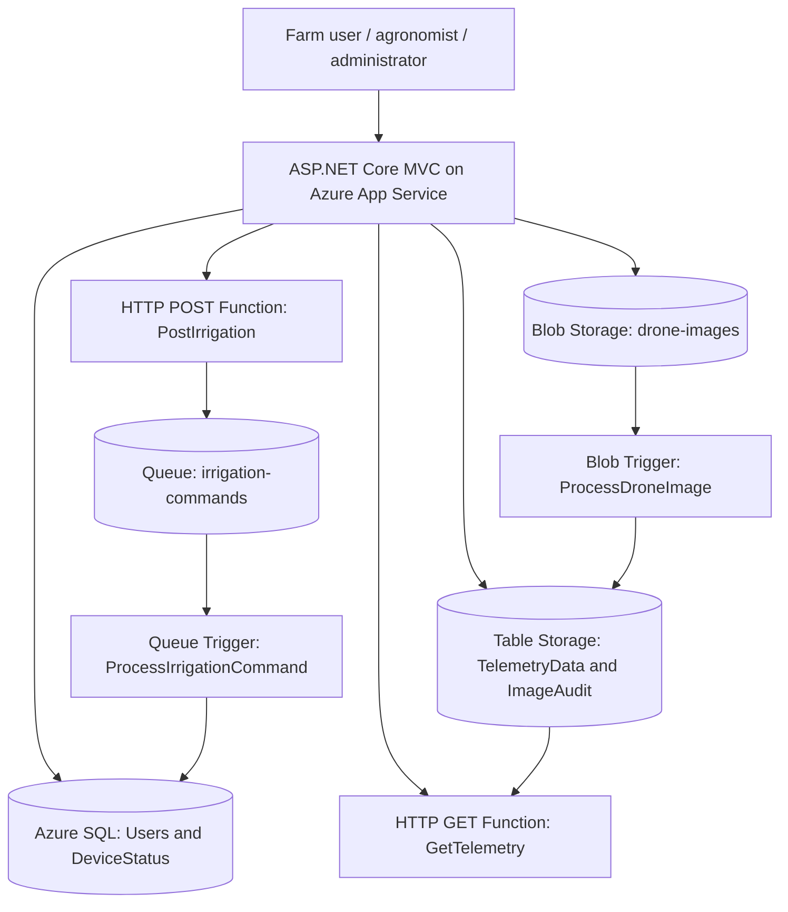

# AgriStream IoT Architecture

## Processing paths

1. **Drone imagery:** MVC validates and uploads an image to the private `drone-images` container. `ProcessDroneImage` reacts to the blob and creates an audit entity in `ImageAudit`.
2. **Telemetry:** Sensor readings are stored in `TelemetryData` (partitioned by farm/device). The MVC dashboard calls the HTTP GET Function when configured; that function returns recent readings as JSON.
3. **Irrigation:** MVC posts a validated command to `PostIrrigation`. The HTTP function enqueues it. `ProcessIrrigationCommand` consumes the queue message and updates `dbo.DeviceStatus` in Azure SQL. The MVC does not mark a device as irrigating before the queue consumer confirms processing.
4. **User management:** MVC uses SQL Server Authentication for its Azure SQL connection. User passwords are hashed with ASP.NET Core `PasswordHasher<TUser>`; the starter's legacy SHA-256 hashes are upgraded on successful login.
